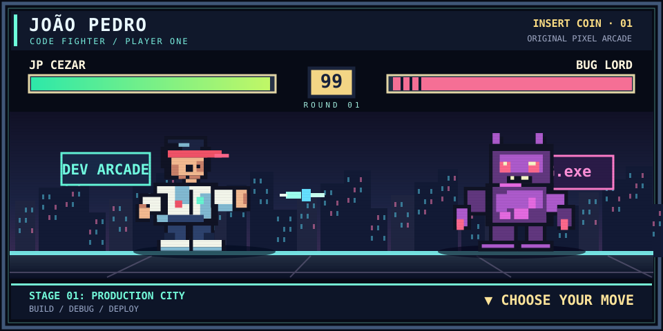
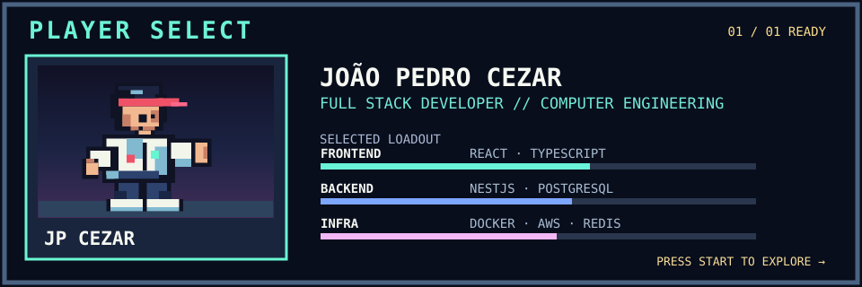

&nbsp;
&nbsp;

<b>ORIGINAL PIXEL ART • ANIMATED SVG • INTERACTIVE STORY MODE</b>

---

<b>🎮 OPEN PLAYER FILE / ABOUT ME</b>

 

I'm **João Pedro Cezar**, a developer and Computer Engineering student from Brazil.

I enjoy building full-stack products, solving backend problems and getting systems reliably into production. My everyday toolkit includes **TypeScript, React, NestJS, PostgreSQL, Redis, Docker and AWS**.

**Current quest:** keep learning, shipping and improving.

<b>⚡ SPECIAL MOVES / TECH LOADOUT</b>

 

| Move | Loadout | Effect |
| :-- | :-- | :-- |
| **PIXEL PERFECT** | React · TypeScript | Build responsive interfaces |
| **API BREAKER** | NestJS · Node.js | Develop APIs and services |
| **DATA SHIELD** | PostgreSQL · Redis | Work with data and caching |
| **CLOUD UPPERCUT** | Docker · AWS | Deploy and operate systems |
| **COMBO EXTENDER** | C · Git | Learn fundamentals and improve workflows |

<b>🕹️ HOW TO PLAY / CONTROLS</b>

 

This README has an interactive **choose-your-move** mini adventure. Click **START GAME** to battle the Bug Lord, choose an action and navigate to a different outcome.

It uses standard GitHub Markdown links, with no JavaScript, installation or external game server.

**Controls:** click a move → discover the result → continue or retry.

---

### ROUND 01 — PRODUCTION CITY

A mysterious bug has infiltrated production. The build is red. The timer is running.

**Do you debug, deploy anyway, or roll back?**

© CODE FIGHTER · An original arcade-inspired GitHub profile · No official game assets used

