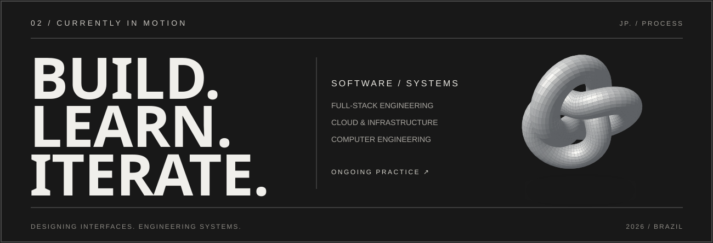

 

<a href="#about">ABOUT</a> &nbsp;&nbsp;·&nbsp;&nbsp;
<a href="#stack">STACK</a> &nbsp;&nbsp;·&nbsp;&nbsp;
<a href="#activity">NOW</a> &nbsp;&nbsp;·&nbsp;&nbsp;
<a href="#stats">GITHUB</a> &nbsp;&nbsp;·&nbsp;&nbsp;
<a href="https://github.com/joaopedrocezar?tab=repositories">PROJECTS ↗</a>

  

COMPUTER ENGINEERING STUDENT&nbsp; / &nbsp;FULL-STACK DEVELOPER&nbsp; / &nbsp;BRAZIL

---

<table border="0">
<tr>
<td width="62%" valign="top">

### A little about me

I'm João Pedro — a Computer Engineering student and full-stack developer interested in the details behind great digital products.

I work across frontend, backend and infrastructure, with a focus on building useful interfaces and reliable systems.

</td>
<td width="38%" valign="middle" align="right">

</td>
</tr>
</table>

### Selected tools

  

TOOLS I USE TO DESIGN, BUILD, SHIP AND MAINTAIN SOFTWARE.

---

### Currently in motion

<strong>What I'm exploring</strong>

- Full-stack product development
- Backend architecture and API design
- Cloud infrastructure, containers and CI/CD
- Computer Engineering fundamentals

---

### GitHub, in numbers

  
  &nbsp;
  

  LIVE DATA · GENERATED FROM PUBLIC GITHUB ACTIVITY

---

<a href="https://github.com/joaopedrocezar?tab=repositories">EXPLORE MY WORK ↗</a>

  

DESIGNED WITH INTENTION. BUILT WITH CURIOSITY.

