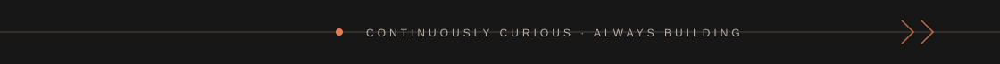

 

<a href="#about">ABOUT</a> &nbsp;&nbsp; / &nbsp;&nbsp;
<a href="#selected-tools">TOOLS</a> &nbsp;&nbsp; / &nbsp;&nbsp;
<a href="#currently">CURRENTLY</a> &nbsp;&nbsp; / &nbsp;&nbsp;
<a href="#selected-data">DATA</a> &nbsp;&nbsp; / &nbsp;&nbsp;
<a href="https://github.com/joaopedrocezar?tab=repositories">WORK ↗</a>

  

INDEPENDENT THINKING. CONTINUOUS BUILDING.

### 01 / ABOUT

**João Pedro Cezar** — Computer Engineering student and full-stack developer based in Brazil.

I build interfaces and backend systems, and work across application development, infrastructure and product thinking.

<strong>READ MORE / A SHORT INTRODUCTION ↗</strong>

 

I enjoy exploring how software is designed, developed, tested and operated — from the smallest interaction to the systems supporting it. I am especially interested in thoughtful interfaces, robust APIs and pragmatic engineering.

---

### 02 / SELECTED TOOLS

THE TOOLS ARE NOT THE WORK. THEY MAKE THE WORK POSSIBLE.

  

`TYPESCRIPT` &nbsp; / &nbsp; `REACT` &nbsp; / &nbsp; `NESTJS` &nbsp; / &nbsp; `NODE.JS`

`POSTGRESQL` &nbsp; / &nbsp; `REDIS` &nbsp; / &nbsp; `DOCKER` &nbsp; / &nbsp; `AWS`

<strong>VIEW TECHNOLOGY ICONS ↗</strong>

 

---

<strong>CURRENTLY EXPLORING ↗</strong>

 

- Full-stack product development
- Backend architecture and API design
- Cloud infrastructure, containers and CI/CD
- Computer Engineering

---

### 03 / SELECTED DATA

GITHUB ACTIVITY / A TECHNICAL FOOTNOTE, NOT THE MAIN STORY.

<strong>OPEN GITHUB STATISTICS ↗</strong>

 

Dynamic statistics rely on a third-party service and may occasionally be unavailable.

---

04 / SELECTED WORK

  

<strong><a href="https://github.com/joaopedrocezar?tab=repositories">EXPLORE REPOSITORIES ↗</a></strong>

  

JOÃO PEDRO CEZAR © 2026 &nbsp;&nbsp;·&nbsp;&nbsp; DESIGN / ENGINEERING / SYSTEMS

