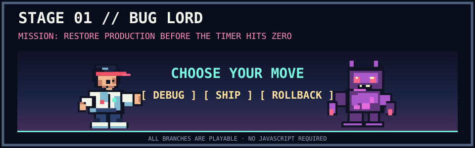

[← BACK TO CHARACTER SELECT](../README.md#character-select) · [↻ RESTART GAME](./start.md)

# ROUND 01 — THE PRODUCTION BUG

**ALERT:** Production is failing. An unknown bug has challenged you to a match.

Your HP is full. You have three moves available. **Choose wisely.**

| Move | Risk | Action |
| :--- | :--- | :--- |
| **DEBUG COMBO** | Medium | [Inspect logs and isolate the cause →](./debug.md) |
| **BLIND DEPLOY** | Very high | [Push without running tests →](./deploy.md) |
| **ROLLBACK SHIELD** | Low | [Restore the last stable build →](./rollback.md) |

🎮 PLAYER TIP

Read the logs before trusting a fix. Being fast and being right aren't always the same thing.

