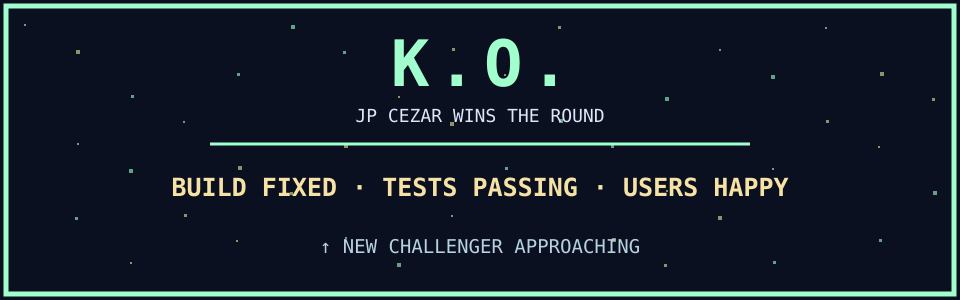

[← BACK TO CHARACTER SELECT](../README.md#character-select) · [↻ RESTART GAME](./start.md)

# YOU WIN — PERFECT RELEASE

The bug has been defeated. The checks are green, production is stable and the users are happy.

**UNLOCKED:** *Debug before deploy* — legendary developer instinct.

**[↻ PLAY AGAIN](./start.md)** · **[VIEW REAL PROJECTS](https://github.com/joaopedrocezar?tab=repositories)**
